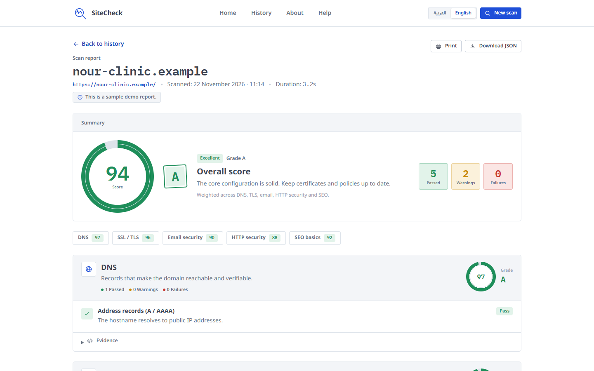
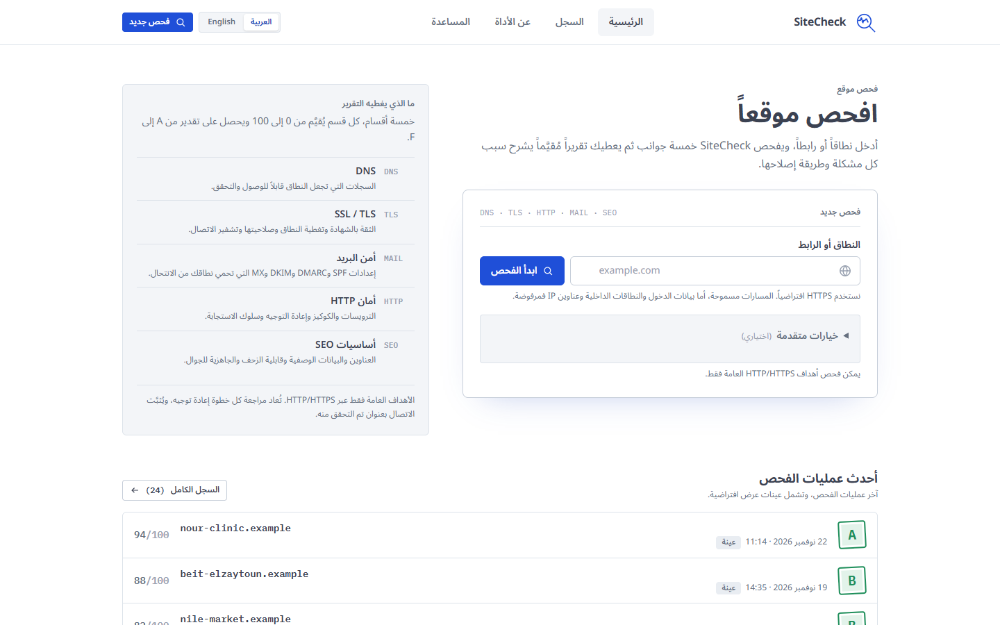
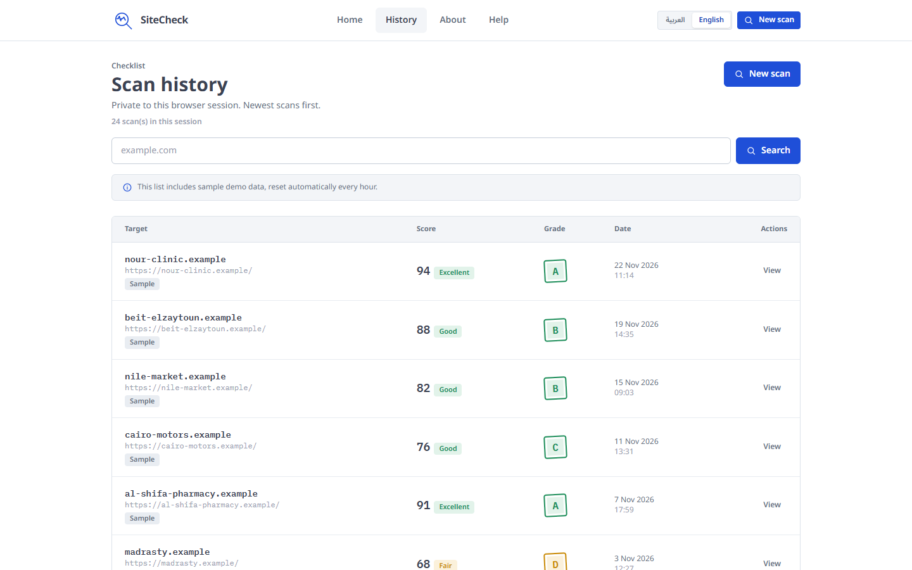
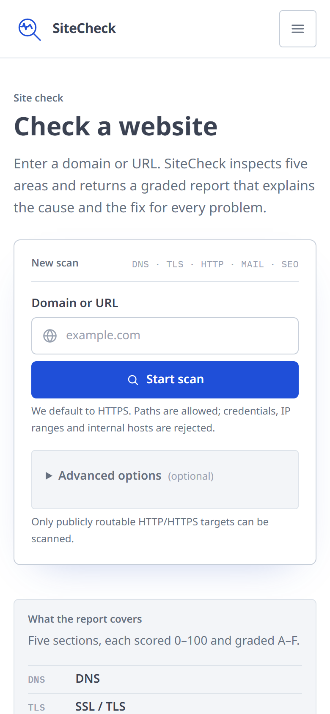
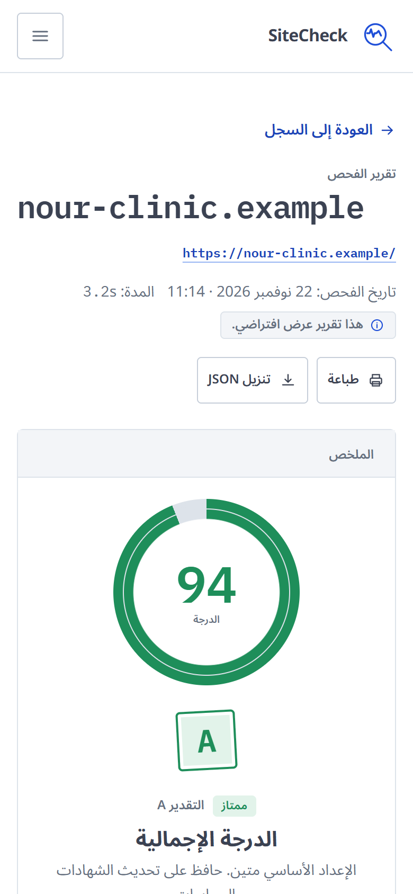
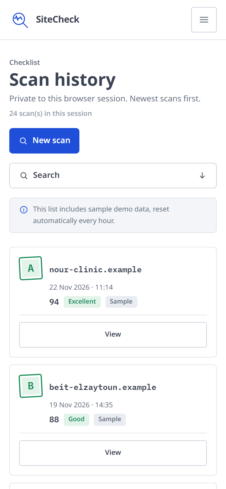
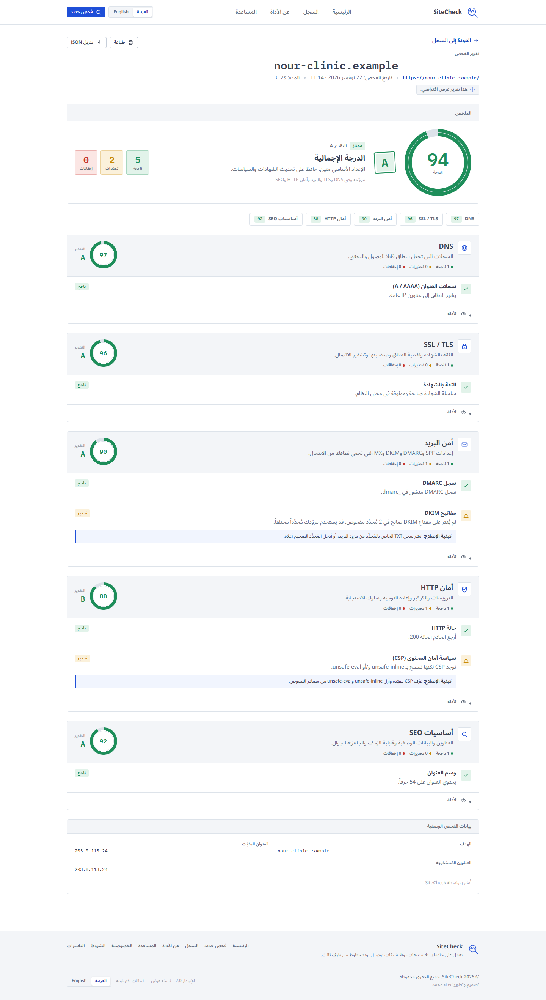

# SiteCheck

Website health check: DNS, SSL/TLS, email security, HTTP headers and SEO in one graded report.



Enter a domain and SiteCheck runs real network checks, then presents the results as a clear report: a score for each area, an overall grade from A to F, prioritised findings, and for every problem its cause and the fix.

The interface is Arabic-first (right-to-left) with a complete English version.

## Highlights

- **Five check areas:** DNS, SSL/TLS, email security (SPF, DKIM, DMARC, MX), HTTP security headers and SEO basics, combined into a weighted score.
- **Actionable findings:** every issue is explained as problem → cause → fix, with raw evidence that can be expanded.
- **SSRF protection:** every hostname is resolved and validated, the connection is pinned to the checked IP, and every redirect is re-validated.
- **Private history:** scans are stored in SQLite and scoped to the browser session, with search, re-scan and delete.
- **Exports:** print-ready report and full JSON.
- **Rate limits** per session and per IP, with strict timeouts and response-size caps.

## Screenshots

**New scan** · Arabic



**Scan history** · English



**On mobile** (English and Arabic)

<p>
  
  
  
</p>

<details>
<summary><b>Full report page</b></summary>



</details>

## Tech stack

| Layer | Technology |
| --- | --- |
| Backend | PHP 8.4, Laravel 13 |
| Frontend | Blade, Tailwind CSS 4, a small vanilla JS layer, Vite 8 |
| Database | SQLite |
| Fonts | Noto Sans Arabic and IBM Plex Mono, self-hosted |
| Tests | PHPUnit, with the network mocked |

No CDNs, trackers or analytics. All fonts and assets are self-hosted.

## Running locally

Requirements: PHP 8.3+ with the `pdo_sqlite`, `sqlite3`, `mbstring`, `fileinfo` and `zip` extensions, Composer 2, Node.js 24 and npm.

```bash
composer install
cp .env.example .env
php artisan key:generate
touch database/database.sqlite
php artisan migrate --seed
php artisan storage:link
npm install
npm run build
php artisan serve
```

Then open http://127.0.0.1:8000.

Full setup notes are in [INSTALL.md](INSTALL.md).

## Demo access

No sign-in. Sample scans of fictional `.example` domains are shown so the history and reports are populated; they reset every hour (`php artisan demo:reset`). Your own scans stay private to your browser session. Set `DEMO_MODE=false` to hide the samples.

All names, phone numbers, emails and records in the demo are fictional sample data.

## Tests

```bash
php artisan test
```

205 automated tests, all passing at the time of publishing. Details in [TESTING.md](TESTING.md).

## Documentation

- [INSTALL.md](INSTALL.md)
- [TESTING.md](TESTING.md)
- [SECURITY.md](SECURITY.md)
- [ROADMAP.md](ROADMAP.md)
- [docs/ARCHITECTURE.md](docs/ARCHITECTURE.md)
- [docs/DECISIONS.md](docs/DECISIONS.md)
- [THIRD-PARTY-NOTICES.md](THIRD-PARTY-NOTICES.md)

## License

Copyright © 2026 Fedaa Mohamed. All rights reserved.

This repository is public so the code can be reviewed. It is **not open source**: no permission is granted to use, copy, modify, distribute or sell any part of it without prior written permission. See [LICENSE](LICENSE). Third-party libraries and fonts keep their own licences, listed in [THIRD-PARTY-NOTICES.md](THIRD-PARTY-NOTICES.md).

---

Designed & built by [Fedaa Mohamed](https://fedaamohamed.com).
